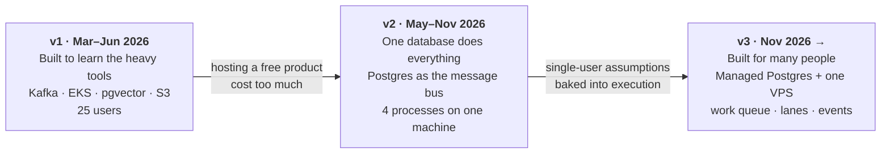

# Demp: three architectures for one product

**Demp** finds job postings, matches them to a person, fills in each application in a real browser, and shows every filled application to that person for review. When they press Submit, Demp sends it. The person never does the mechanical part of applying, but nothing is sent without their approval.

**Live site:** [demp.app](https://demp.app), with a demo video and a clickable toy version of Demp you can try (nothing is ever sent from it). · [How it works](https://demp.app/how-it-works)

Demp was called Dr. Employment until October 2026.

This repo tells the story of the three architectures Demp has run on: what each one looked like, why I built it that way, what broke, and what I changed. It contains documentation and selected code excerpts. It does not contain the product's source code, and you can't run anything from it (see [what's not here](#whats-deliberately-not-here)).

---

## The short version

| | v1 | v2 | v3 |
|---|---|---|---|
| **The bet** | Use the industry-standard distributed stack and get hands-on with it | Strip everything back to one database and see what's actually needed | Keep the simplicity, remove the single-user assumptions |
| **Coordination** | Kafka topics, Postgres, heartbeat leases | Polling one Postgres: request rows, leases, 1-second loops | One work-queue table, `LISTEN/NOTIFY`, lanes |
| **Form filling** | Playwright workers on EKS, custom autoscaler | One Chrome on one machine, one global lock | Two workers × three lanes, fresh browser contexts |
| **Files** | S3 with presigned URLs | Screenshots stored in Postgres rows | Object storage (R2), short-lived signed links |
| **Where Submit runs** | The user's machine | Moving to the user's Chrome through an extension (Greenhouse first, from Oct 29) | The user's Chrome: the extension re-runs the fill with the planned answers, then sends |
| **Why it ended** | Cost far out of proportion to 25 free users | Couldn't serve more than one person at a time | — |

Read in order:

1. **[v1: built to learn](docs/1-v1-built-to-learn.md).** The overbuilt version, and what it taught me.
2. **[v2: one database does everything](docs/2-v2-one-database.md).** The rebuild, the Render plan I pulled, and why.
3. **[v3: the VPS architecture](docs/3-v3-vps.md).** What runs today.
4. **[How Demp learns a job board](docs/4-learning-boards.md).** How a posting finds its playbook, how an unknown board gets learned, and how a fill runs, with code excerpts.
5. **[Decision log](docs/5-decisions.md).** Every major call, what I considered, and what it cost.

---

## What I took away

**Building to learn is fine if you're honest that that's what you're doing.** v1 used Kafka, Kubernetes, pgvector and a custom autoscaler because I wanted to work with them hands-on, not only read about them. It worked for 25 people. But for a free product with 25 users, I was paying distributed-systems hosting bills that the usage didn't justify. Shutting it down was the right call, and the lessons carried over even though the infrastructure didn't.

**A database can be your queue, up to a point.** In v2 I deliberately rejected Kafka and Redis. I'd already run Kafka, and for one team and one database it was a second system to keep alive, with no extra capability I needed. Postgres handled claims, leases and heartbeats well. What failed wasn't the idea but how I'd implemented it: everything polled once a second.

**Single-user assumptions hide in the execution model, not the schema.** v2's tables had a user column by September. The real assumptions were elsewhere: one global lock on form filling, one Chrome for everyone, and SERIALIZABLE transactions on every state change, which works when there's no contention to speak of. v3 is mostly about removing those.

**Learn once, replay many times.** The biggest cost and reliability gains came from not asking an AI model what to do on every form. A dedicated learner works out a job board once. After that, every application on that board replays the learned steps deterministically. A cheap model is called only to pick which stored fact answers a question the rules can't, and that happens before anything is typed.

**Keep the irreversible step next to the person.** Filling runs on servers. Submitting runs in the person's own browser. Partly that's trust, since they see exactly what's sent. Partly it's practical: in a 2026-09-30 test, submits from datacenter IP addresses were blocked by bot checks 4 out of 4 times.

---

## Numbers

All numbers are as of the date shown and come from the project's own records.

| What | Value | As of |
|---|---|---|
| v1: users / applications / interviews | 25 / ~4,500 / 50 | Jun 2026 |
| v2: real applications submitted (one user) | 270 | 2026-11-02 |
| v2: postings ingested | ~8,000 | 2026-10-28 |
| Codebase (v2/v3 repo) | ~70K lines of non-test TypeScript (~28K of it the fill engine), ~9,000 tests, 2,600+ commits | 2026-10-30 |
| AI cost to learn a new board (one Opus learning run, rehearsal on a test database) | $0.18 | 2026-10-30 |
| AI cost of one application on that board afterwards (replay plus the screenshot check) | under $0.01, with no call to the expensive model | 2026-10-30 |
| Parallel vs. serial filling, 9 forms (cloud test) | 324 s vs. ~665 s | 2026-09-30 |
| Database size taken up by screenshots before v3 | 228 MB of 291 MB | 2026-11-02 |
| v3: time from Submit press to fill start | 5 seconds | 2026-11-02 |
| v3: monthly hosting cost | 70$ | 2026-11-02 |

---

## What's deliberately not here

This repo describes the design fully: the flows, the trade-offs, the failures and what replaced them. What it leaves out is the material that took months of failed applications to build up:

- the exact prompts
- how learned boards are stored, and the vocabulary the learner is allowed to write in
- per-board fixes (date pickers, custom dropdowns, upload widgets, multi-page sign-in flows)
- the rules for answering screening and legal questions
- browser settings

The ideas are all here; the accumulated detail that makes them work on dozens of real job boards is not.

---

## Stack

TypeScript on Node · Hono · React 19 + Vite · Postgres 17 · Patchright (a fork of Playwright) driving real Chrome · Anthropic Claude · a Chrome extension for the submit step · Cloudflare R2 · v1 additionally used Kafka, pgvector, Kubernetes (EKS), S3 and Google Gemini.
