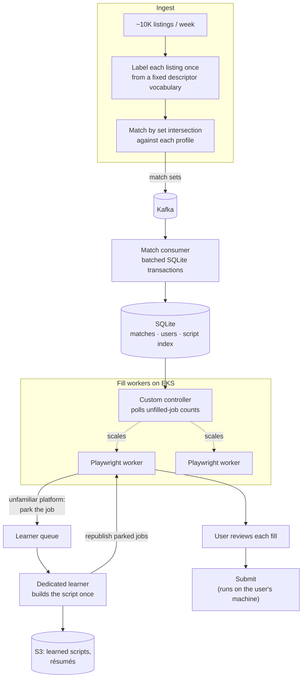

# v1: built to learn (March – June 2026)

> **Status:** shut down June 30, 2026. It lived in a separate repository.

## Why it looked like this

I had a theoretical understanding of connection pooling, message brokers and container orchestration, and I wanted hands-on experience with them. So v1 was built on the stack a large company would reach for: Kafka between services, form-filling workers on Kubernetes (EKS) with a custom autoscaler, pgvector for matching, and S3 for files.

It worked. It served **25 users**, sent **~4,500 applications** and produced **50 interviews**. But it was a free product, and the hosting bill for a distributed system serving 25 people made no sense. I shut it down on June 30. A month earlier I'd started v2 as a deliberately small rebuild.

## What it did

Every week v1 ingested about 10,000 job listings, matched them to user profiles, and filled application forms across 40+ applicant tracking systems (ATS: the hiring software, such as Greenhouse, Lever or Workday, that hosts a company's application forms). Each filled form waited for the user to review it, and only then was submitted.

## The decisions worth talking about

### Matching cost that grows with listings, not listings × users

The first matcher was a pgvector retrieve-and-rerank pipeline: a bi-encoder pulled candidate listings and a cross-encoder reranked them per user. Its cost grew with the number of users, because every new user needed their own pass over the listings.

I replaced it with **labeling each listing once, at ingest**, from a fixed vocabulary of descriptors, and **matching by set intersection** against each profile. Hard constraints, like work authorization and seniority, act as gates before any soft preference is considered. Model cost became linear in listings. Adding a user adds no model calls.

### Learn each form once, then replay it

The first form filler used a self-healing design, and its failures couldn't be reproduced.

I replaced it with **learning each unfamiliar form once**. A model maps the page's accessibility tree onto a declarative schema and resolves the selectors, and the result replays as a deterministic script. The model is called again only for free-text questions the profile can't answer. That cut LLM spend about **8×**.

Scripts are invalidated **when they fail, not on a timer**. ATS layouts change unpredictably, so any fixed lifetime would be either too short (paying to relearn forms that still work) or too long (replaying a broken script).

### A dedicated queue for learning

The first learning design was lease-based. Moving learning to **its own queue** made it more than 30% faster.

When a fill worker meets an unfamiliar platform, it parks the job. A dedicated learner builds that platform's script once, stores it in S3 with an index in SQLite, and republishes the parked jobs. One user's unfamiliar platform becomes every later user's cached one.

### Filling unattended

Batches went from **40–45 minutes of the user watching** to **~15 minutes unattended**, by moving form filling to Playwright workers on EKS.

- **Scaling:** a custom controller scaled the workers by polling the count of unfilled jobs in SQL.
- **Fairness:** each worker assigned itself to the user queue that had been served least, under a heartbeat lease, with one user per worker at a time.
- **Submit:** this step stayed on the user's machine.

### Crash-safe match delivery

Matches were consumed from Kafka in batched SQLite transactions, with **offsets committed only after the write**. A crash mid-batch meant redelivery, never a dropped batch.

Redelivery itself was made safe at two points. A uniqueness constraint on matches meant a redelivered match couldn't create a duplicate. An idempotent submit API meant a repeated submit request couldn't send an application twice.

### Multi-tenant hardening

Users' personal data and ATS credentials were protected by:

- application-level field encryption
- log redaction (Pino)
- résumés behind short-lived presigned S3 URLs
- per-user storage isolation, audited before rollout

## What I kept and what I dropped

| Kept (it shows up again in v2/v3) | Dropped |
|---|---|
| Learn once, replay deterministically | Kafka: one database turned out to be enough |
| A separate learner with its own queue | Kubernetes and the custom autoscaler: a fixed pool of workers on one box covers this load |
| Invalidate learned scripts on failure, not on a timer | SQLite as the system of record |
| Submit runs next to the user | pgvector and the per-user rerank |
| Fair scheduling across users | |
| Encrypted credentials, redacted logs, short-lived file links | |

The lesson I took from v1 wasn't that those tools are bad. It was that the size of the infrastructure should follow the load, not what I want to learn next. v2 started from the other end: the least infrastructure that could possibly work.
