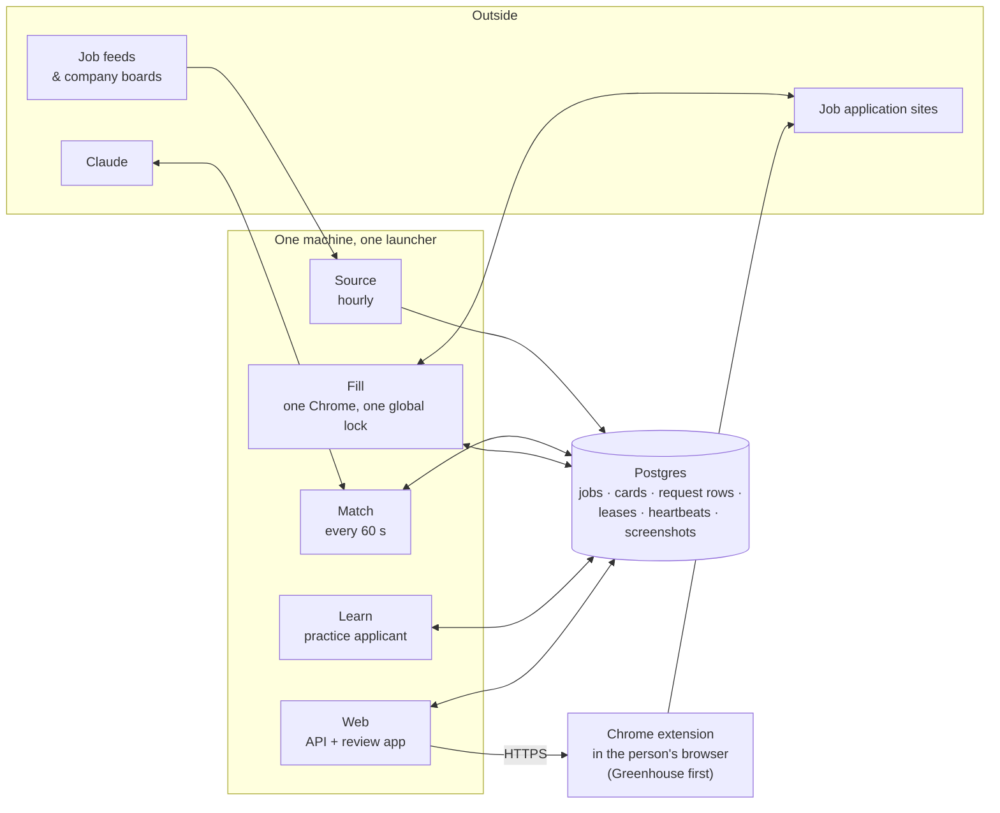

# v2: one database does everything (June – November 2026)

> **Status:** replaced by [v3](3-v3-vps.md). The planned move of v2 to Render was designed and partly built, then dropped before any worker went live.

## The idea

While v1 was still serving its users, I wanted to find out how little infrastructure Demp actually needed, and I wanted a version small enough to redesign one process at a time and test on my own applications. v2 started on 2026-05-30 as a small program on one Mac: pull a GitHub feed of new-grad job postings, store them in SQLite, and send a Slack message. It was built for one person and was never meant to take anyone else. Over the next five months it grew back into the full product, including several of v1's best ideas: learning a board once, a separate learner, and submitting from the person's own machine. None of the heavy infrastructure came back with them.

## How it grew

| When | What changed |
|---|---|
| 2026-05-30 | Design spec; code starts 06-08 as SQLite on a Mac |
| Jun | Hand-written fill drivers for Greenhouse, then Lever, later Ashby |
| Aug – Oct | A self-taught engine for every other board ([details](4-learning-boards.md)) |
| 2026-09-26 → 10-20 | **Decoupling:** one program split into four processes (source, match, fill, web) under a launcher, in 12 steps, each merged and running before the next started |
| 2026-10-19 | Decision: no Kafka, no Redis. One shared database |
| 2026-10-21 | SQLite → **Postgres 17**, still on the Mac |
| 2026-10-22 | Hosting groundwork live: accounts and invites, AI through the Anthropic API, screenshots in the database, a container image, a Render blueprint |
| 2026-10-29 | Greenhouse submits move into the person's own Chrome through an extension |
| 2026-10-30 | Learning moves into its own process with a practice applicant |
| 2026-11-02 | Render plan dropped; v3 designed |

## The architecture

### The database is the message bus

There was one Postgres database and no queue, cache, or calls between services. Each process polled for work and wrote its results back. (A **card** below is one application for one person: the filled form plus its screenshots, waiting for review.)

- **Request rows.** A button press, like Edit, Retry or Submit, inserts a row. The right process claims it atomically, does the work, and writes the outcome.
- **Leases.** A lease is a lock row with a holder and an expiry, and it keeps single-copy processes single. It records the holder's process id and start time, so a dead holder is taken over at once and a slow but live one is never robbed.
- **Heartbeats.** Every process writes its own row about once a second. A row older than 90 seconds means that process is down, and the app says which one.
- **Change watcher.** The web process re-read four tables every second and pushed "something changed" hints to open browsers, which then re-fetched.
- **Strict transactions.** Every multi-step write ran at `SERIALIZABLE` isolation and retried up to three times. No transaction was ever held open across a browser or AI call.

### Why not Kafka or Redis?

I'd just run Kafka in v1, so this wasn't avoiding something unfamiliar. A queue would have been a second system to run *beside* the database, not instead of it, because the database still holds the truth. A cache is where "one source of truth" dies. I decided to revisit this only if there were ever several consumers or a second stack.

### Where Submit runs

On 2026-09-30 I ran fills and submits from a cloud machine. Filling held up: 10 of 11 fills matched the Mac's. **Submitting didn't: 4 of 4 were blocked** by spam and captcha checks that don't trust datacenter addresses. So from 2026-10-29, submits started moving to a Chrome extension, Greenhouse first, with other boards still sent from the Mac. The server fills the application, the person reviews it, and their own browser sends it from their own connection.

## The Render plan, and why I pulled it

The plan was to move the four processes to Render, alongside a managed Postgres. The groundwork shipped on 2026-10-22 (accounts, a container image, a blueprint), and the public website does run on Render. The workers never did. Before cutting over, I took a hard look at what I'd be deploying, and the design had problems no hosting provider would fix:

| Problem | What it meant | Evidence |
|---|---|---|
| **One global lock on Fill** | One Chrome and one application at a time, for everyone. Person B waits behind person A's whole batch | 9 fills took ~665 s in series and 324 s in parallel (cloud test, 2026-09-30). One learning run once delayed a person's press by 13.6 minutes |
| **One-second polling loops** | Watchers, heartbeats and the request timer all asked "anything new?" every second instead of being told | Never load-tested at more than one user; it would get worse with each one |
| **SERIALIZABLE for simple state changes** | Too cautious. A queue claim doesn't need it, and with many workers it means retry storms | Carried over from SQLite, where one writer at a time came free |
| **Files stored in database rows** | Screenshot PNGs made the database heavy, slowing backups and restores | Screenshots were 228 MB of a 291 MB database after two weeks of one person, growing ~50 MB a day |
| **List counts computed per card** | The sidebar counts got 9× slower after the move to Postgres | 4.1–5.4 s on Postgres vs. 0.46–0.57 s on SQLite, from ~11,000 small queries per refresh. The patch was a stored table with a single writer, which added another single-instance part |
| **Server-fill vs. client-submit split unresolved** | The hosted design had no clear answer for boards the extension didn't support yet | Open in the 2026-11-02 review |
| **One browser shared by everyone** | One person's sign-in on a job board could carry into another person's fill | Found in the same review |

Cost was secondary but not small. Chrome needs about 2 GB per worker, and the blueprint's placeholder plans gave each worker 512 MB. Sized realistically, four Render services came to roughly $240 a month, before the database.

The common thread: **v2 was a single-user system whose tables happened to have a user column.** Splitting it into processes hadn't changed that, and moving it to Render wouldn't have either.

## What v2 got right

- **One source of truth.** Every state change is a row; every process is replaceable.
- **Work survives crashes.** Leases with stale takeover, and a database-level rule allowing only one live submit per application.
- **Small, reversible steps.** Twelve decoupling steps, each merged and running before the next, and a full backup restore tested before the move.
- **The submit split.** Fill on servers, send from the person's browser. v3 keeps it.
