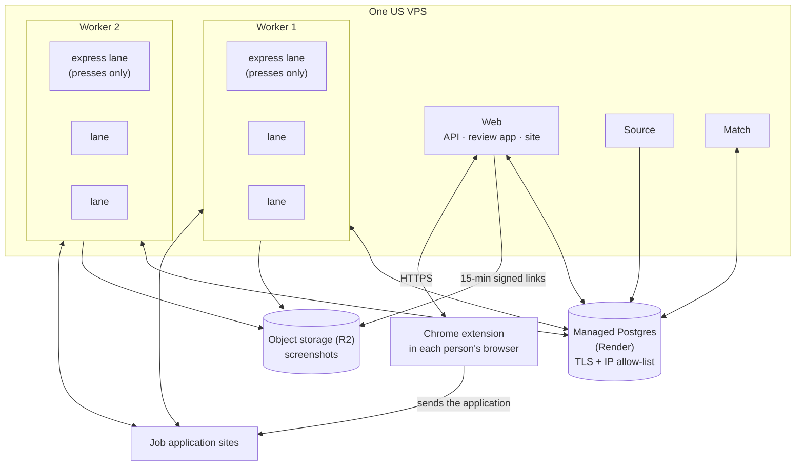
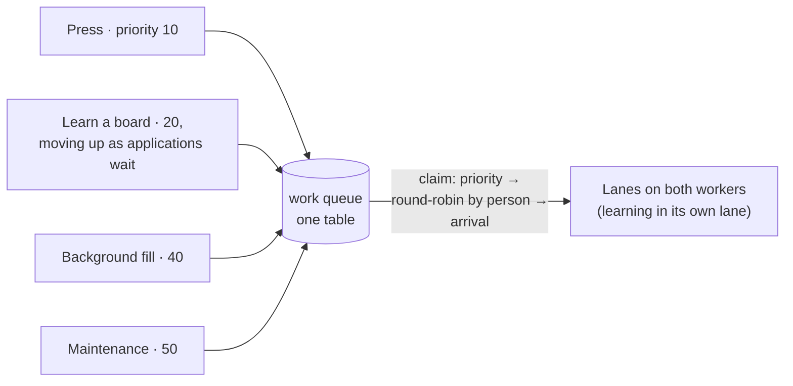
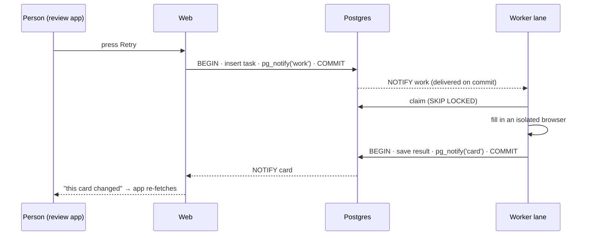

# v3: the VPS architecture (November 2026 →)

> **Status:** current.

## The goal

Keep v2's best property, one database as the single source of truth with no extra moving parts, and remove every assumption that there's only one person. v3 was built in six steps, each shipped on its own:

1. Files out of the database
2. One work queue, with lanes
3. A pool of isolated browsers
4. Learning moved upstream into the queue
5. Sidebar lists computed by the database itself
6. Cutover and hardening, including row-level security

## Where things run

**Why this split:** the database is the one piece where I want backups and point-in-time recovery handled by someone else. Render's managed Postgres was the cheapest option with recovery when I compared prices on 2026-11-02 ($6/month with 3-day point-in-time recovery, against $15 at DigitalOcean and $25 + $100 for recovery at Supabase). Everything else is stateless and runs on one VPS, where a 2 GB Chrome doesn't cost a premium. The trade-off is that every page load crosses the internet to reach the database. If that ever proves slow, the web process moves next to the database, which is a configuration change, not a rewrite.

## 1. One work queue, with lanes

Every piece of browser work is a row in one table. That covers a person's **press** (a button they clicked: Edit, Retry, Submit, Re-fill), a background fill of one application, learning a new board, and maintenance.

- **Order.** Priority first, then round-robin across people so nobody's batch starves anyone else's, then arrival time.
- **Per-board cap.** At most two lanes work on any one job board at once, counted *in the database*, so the cap holds across both workers.
- **Claiming.** One short `READ COMMITTED` transaction: a shared advisory lock plus `FOR UPDATE SKIP LOCKED`. Claims are serialized across all lanes, which costs a few milliseconds each and buys an exact cap and exact fairness. `SERIALIZABLE` is never used here.
- **Leases.** A claimed task holds a lease that is renewed every 40 seconds, and a sweep every 60 seconds returns lapsed ones to the queue. A fill whose lease lapses twice goes to a human-review list instead of looping forever.
- **Lanes.** A lane is one browser plus a filter on which kinds of work it takes; every fill in it gets a fresh browser context. Each worker has an **express lane** that only takes presses, so pressing Retry starts within seconds even while every other lane is in the middle of a long background fill.
- **Stopping.** Putting an application away stops its fill at the next step, and the partial work is discarded. A submit that has announced "about to click" is never stopped or re-queued.

This replaced v2's single global fill lock and its one-second idle loop.

## 2. Events instead of polling

Postgres `LISTEN/NOTIFY` replaces the one-second loops. There are three channels: new **work**, a **card** (one person's application) changed, and **cancel**. Each notification is sent inside the transaction that made the change, so it fires only if that change commits, and a listener never hears about a row it can't yet see. Polling stays only as a safety net. The web watcher's interval went from 1 second to 30 seconds, workers poll every 15 seconds, and a listener that reconnects does one catch-up read for anything it missed.

That's still one database and no new component: the queue I didn't want to add in v2 turned out to be a table and a notification channel.

## 3. Isolation where it's needed

- **Queue operations** (claims, lease renewals, single-row progress saves) run at `READ COMMITTED` with explicit row locks.
- **Application state** stays `SERIALIZABLE`, but every retried conflict is logged with the name of its transaction, so a hot spot shows up in the logs.
- The database itself allows only one live submit per application.
- **Row-level security** went on before the first person outside the project was invited. v2 kept people's data apart by making every query name its owner, and that's easy to forget once. An earlier multi-user branch was abandoned after review found six places where one person's data could reach another.

## 4. Browsers that don't share anything

Every fill runs in a fresh browser context, so no cookie, sign-in or saved form value carries from one person's application to another's.

## 5. Files out of the database

Screenshots go to private object storage (Cloudflare R2) as WebP, about a tenth the size of a PNG, uploaded *before* the application row is saved, so a row never points at a missing file. The database keeps only the object key. The review app loads pictures through signed links that expire after 15 minutes.

**Retention follows the application, not a calendar:**
- kept while the application is unfinished
- review screenshots deleted 30 days after it's submitted or skipped
- the confirmation screenshot of a sent application kept for the life of the account

## 6. Lists computed by the database

The sidebar ("Ready to review", "Needs your answer", and so on) used to be recomputed in application code by a single writer process. Now the list rules are SQL, kept current by triggers on the five tables that affect them. The single process that used to own those counts is gone.

## 7. Learning moves upstream

When matching finds a posting, its URL is checked against the boards Demp already handles, by hand-written driver or learned playbook. A known board goes straight to the fill queue. An unknown one becomes a **learn this board** task in the same queue, starting at priority 20 and moving up as more applications wait on it. The learner first checks whether the page is really a known board in disguise (a company careers page with a Greenhouse form embedded in it, say): it runs that ATS's driver or playbook once as the practice applicant, and if that's clean, the posting and its site are labeled with the ATS. Only then does it learn anything from scratch. No one's fill ever stops to learn. See **[How Demp learns a job board](4-learning-boards.md)**.

- **Spending:** each learning attempt has a cap on model turns (40 per page, 120 per job), and running out counts as a failed attempt, so three strikes bound what any one board can cost.
- **Giving up:** after three failed attempts the board is flagged for an admin, and its waiting applications go to a human-review list. Nothing is silently dropped.
- **Gone postings:** a posting proven gone by two independent signals is closed for everyone, with re-checks at 3 and 14 days, because a live job must never be hidden for good.

## Numbers

| What | Value |
|---|---|
| Time from a press to its fill starting | 5 seconds |
| Background fills per hour, both workers | ~90 |
| Memory per lane | ~750MB |
| Database size after files moved out | 900MB |
| Monthly hosting cost | $70 |
