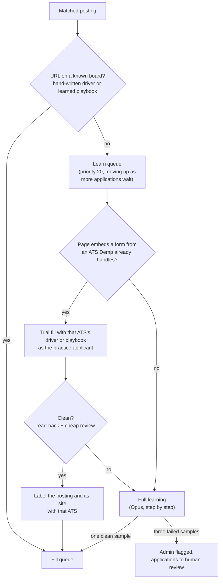
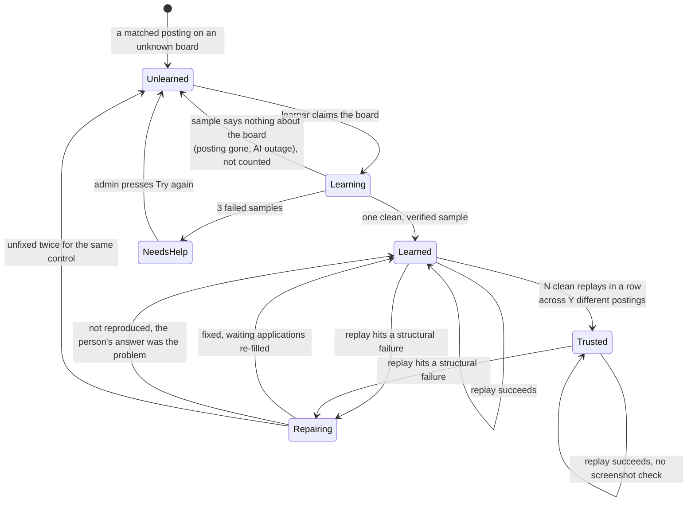

# How Demp learns a job board

Job applications live on dozens of different hiring systems. A few are big and consistent (Greenhouse, Lever, Ashby). The long tail is hundreds of smaller platforms and one-off company career sites, each with its own widgets, page flows and quirks.

Demp handles them in two ways:

- **Known boards** have hand-written drivers. Every driver implements the same interface: read the form, fill one field, recognise the final Submit control, and check whether the posting is still live.
- **Every other board** goes through the **self-taught engine**, which implements that same interface. Instead of hand-written code, it uses a playbook the engine learned itself: how to get into the application, what each box needs, and how to move to the next page.

This page covers the self-taught engine, which is the part that took the most iterations: how a posting finds its playbook, how an unknown board gets learned, and how a fill runs once it has one.

## The core idea: learn once, replay many times

Asking an AI model to fill every form live is expensive and doesn't repeat. The same form can come out differently on two runs, so failures can't be reproduced. Demp splits the work instead:

1. A **learner** works out a board **once**, using an expensive model (Claude Opus) that operates the page step by step through a small set of guarded tools.
2. Only the steps that worked are saved as that board's playbook.
3. Every later application on that board **replays the playbook deterministically**. The expensive model isn't called at all. A cheap model (Claude Haiku) is used only to pick which stored fact answers a question the rules can't, before anything is typed, and, on boards not yet trusted, to look over the finished form.

In one rehearsal on a test database (2026-10-30), learning a new board (one Opus run, start to finish) cost **$0.18** of AI calls. Each application on it afterwards, replayed with the screenshot check, cost **under $0.01**, with no call to the expensive model.

## From posting to playbook

Every matched posting is routed before any browser work happens:



## A board's life



### 1. Queue

A matched posting whose URL isn't on any known board puts one **learn this board** task in the work queue. A learn task starts at priority 20 and moves ahead of other learn tasks as more applications wait on its board. A person's fill never stops to learn: it moves on, and the application waits until the board is learned.

### 2. Check for a known board in disguise

Many company careers pages are a known ATS underneath: the page lives on the company's own site, but the application form is a Greenhouse or Lever form embedded in it. Learning those from scratch would mean paying to learn a board Demp already handles.

So before learning anything, the learner opens the page and inspects its code for an embedded application form from an ATS Demp already handles, whether by a hand-written driver or a learned playbook. If it finds one:

1. It fills the posting once with that ATS's driver or playbook, as the practice applicant (below).
2. The trial has to pass the same bar as a newly learned board ([step 4](#4-verify-before-trusting)).
3. If it passes, the posting and its site are labeled with that ATS. Later postings on the same site skip the trial and go straight to the fill queue.
4. If it fails, the posting goes through full learning as a new board.

The trial exists because embedded forms are often tweaked: extra company questions, restyled controls, a field the hosted version doesn't have. Recognizing the ATS tells Demp which driver or playbook to try, not that it will work. A recognized embed costs one page load, one replay and one cheap review instead of a full learning run.

### 3. Learn, as a practice applicant

The learner never uses a real person's profile. It applies as a **practice applicant**, a made-up person whose profile is deliberately rich enough to exercise every kind of question, in its own isolated browser. It stops before Submit, every time.

Learning is driven by Claude Opus, **step by step**. The model sees a text snapshot of the page in which every control has a short tag (`textbox "City" [ref=e7]`), and it acts only through a few tools: look, click, type, pick, upload, press a key, wait. Each tool call names a tag and, for typing, a question key (`q3`); code types that question's planned answer. After each action the model gets the result and a fresh view of the page, and decides the next one, up to 40 turns per page and 120 per job. It can send several actions in one reply, but a tag only points at the page as it looked in the latest snapshot, so an action that changes the page ends the batch and the model re-reads.

Rules in code decide what it may **not** do, whatever it decides:

- type a real answer itself (answers come from the plan, never from the model)
- press the final send control, or any key that could send one
- leave the application, sign out, or delete anything

Why step by step rather than one plan for the whole page: a one-shot plan is a guess about a page the model hasn't seen yet. Questions appear after answers, dropdowns don't show their options until opened, wizards span pages, upload boxes redraw themselves. The earlier one-shot design is in the [history table](#how-it-got-here).

### 4. Verify before trusting

One clean sample is enough to learn a board, but "clean" is strict:

- every required box reads back the value it was given
- every page advances
- the final Submit control is found, and not pressed
- Claude Haiku then reviews the attempt: the practice profile, the résumé it was given, and screenshots of the whole filled form, looking for anything empty, wrong, or showing a validation error

The model never decides alone. The read-back and page checks have to pass first, and a review that couldn't run never counts as a pass.

### 5. Failures that don't count

A sample that tells us nothing about the board isn't counted against it. That covers a posting that turned out to be closed, and an AI outage. Only real failures count, and three of those park the board for an admin. On a crash or outage the claim is released, the attempt isn't counted, and the error goes up to the caller:

```ts
} catch (e) {
  await releaseLearning(db, fam.family, owner, 'unlearned');   // never burn a sample on a crash or an offline machine
  throw e;
}
```

### 6. Filling: replaying a playbook

Once a posting has a playbook, filling it for a real person is deterministic:

- **Answers are planned before anything is typed.** Fixed rules go first: name, email and phone straight from the profile, demographic questions always declined, consent boxes ticked. Then the person's answer cache, which stores *which stored fact answers a question wording*, never the answer text, so a changed phone number reaches every cached question. Whatever is still unanswered goes to the cheap model in one batched call, and it picks which fact answers each question. The result is a plan: `q1` → first name, `q3` → city.
- The playbook's steps replay from the plan: get into the application, fill each box, move to the next page. No model is called during the replay.
- Every box is read back after it's filled.
- The filler stops at the final Submit control and screenshots the form. On a board that isn't yet **trusted**, the cheap check looks the screenshots over. A board becomes trusted after N clean fills in a row across Y different postings; a structural failure sends it back to the checked state.
- The filled application becomes a card for the person to review. When they press Submit, the extension re-runs the fill script with the planned answers in their own Chrome and sends it, and Demp keeps the confirmation screenshot.

The form is filled twice on purpose. The server fill produces the card: it runs in the background with the person's browser closed, and it's where the read-back, the resolver and the screenshot check happen. The extension's replay is the submit step: the same script and the same plan, run on the person's own connection, because submits from datacenter addresses are blocked ([v2: where Submit runs](2-v2-one-database.md#where-submit-runs)). What the person reviewed and what gets sent are the same fill, run twice.

The screenshot check is told **whether** each box was answered, never **what** the answer was, so no personal value reaches that call:

```ts
/** The cheap screenshot check. One look at a filled form's pictures: which boxes look empty, wrong, or show a
 *  validation message. The plan says WHETHER a box was answered, never what the answer was, so no personal
 *  value reaches this call. */
export interface FillCheckItem {
  label: string; type: string; required: boolean;
  planned: 'answered' | 'left-blank' | 'file';
  readBack?: 'verified';   // the filler's own read-back already confirmed this box
}
export type FillCheckProblem = { label: string; kind: 'empty' | 'wrong' | 'validation' | 'not-shown'; reason: string };
export type FillCheckReport = { ok: true } | { ok: false; problems: FillCheckProblem[] };
```

### 7. When a replay fails: whose problem is it?

When a replay can't fill a box, the important question is **whose problem it is**:

- **The board's** (structural): the control isn't there, isn't what was recorded, the click didn't take, or a new required box appeared. The fill stops, the application waits, and the board goes back into the learning loop as a **repair job**.
- **The person's**: their saved answer matches none of the options, or they have no document for an upload. The box is flagged for the person, and the application goes to review as normal.

That decision is one small rule:

```ts
/** A replay failure is the board's when the control is not found, is not what was recorded, the gesture does not
 *  take, the stored step left the page or would press the send button, or the box has no stored step at all.
 *  It is the person's when their saved answer matches none of the options, when they have no document for the
 *  question, or when there is nothing to type. */
export function isStructuralFailure(outcome: ReplayOutcome | null, plan: FieldPlan): boolean {
  if (plan.value == null) return false;
  if (outcome === null) return true;
  return !outcome.ok && !PERSONS_FAILURES.has(outcome.failureClass);
}
const PERSONS_FAILURES: ReadonlySet<string> = new Set(['no-option-matches', 'no-document']);
```

Getting this split right matters in both directions. Calling a person's problem structural wastes AI money relearning a board that works. Calling a board's problem the person's asks them to fix something they can't.

### 8. Repair

The learner takes the repair job in its own run, seeded with the board's current playbook, re-runs one of the waiting applications' postings as the practice applicant, and fixes **only the named control**. Repair runs in the learner rather than inside the person's fill so that fills never contain learning code, and so every learning attempt, first or repair, lands in the same telemetry. Every repair ends one of three ways:

| Outcome | Meaning | What happens |
|---|---|---|
| **Fixed** | The new step works and was saved | Every waiting application is re-filled |
| **Not reproduced** | The control worked fine for the practice applicant | It was the person's answer after all; the box is flagged for them |
| **Unfixed** | Still broken | Applications go to human review; a second unfixed repair of the same control sends the whole board back to be relearned |

As in v1, a playbook is invalidated **by failure, not by age**. Boards change without notice, so any fixed lifetime would be either wasteful or stale.

The repair evidence is a text snapshot with every answer, profile fact and file name replaced, plus the cheap check's report. The person's own screenshots never go to the learner.

## Working safely with several workers

The learner and the fill workers share the database, so every handoff has to survive crashes and races.

**Claiming work** is a single atomic statement. It takes the oldest open job, or one whose holder's lock has gone stale because its worker died:

```sql
UPDATE board_repairs SET state = 'claimed', lock_owner = $1, lock_at = $2, updated_at = $2
 WHERE id = (SELECT id FROM board_repairs
              WHERE state = 'open' OR (state = 'claimed' AND (lock_at IS NULL OR lock_at < $3))
              ORDER BY created_at, id
              LIMIT 1
              FOR UPDATE SKIP LOCKED)
RETURNING *;
```

**Holding work.** The claim is renewed at every model turn, screenshot check and database write. A run that loses its claim stops at once and writes nothing.

**Finishing work: applications first, then the job.** A crash between those two steps leaves a claimed job that a later run picks up again. It never leaves a closed job whose applications are still waiting.

**Forced stops give work back** instead of making it wait for a lock to expire. Only the claim's holder can release it:

```ts
export async function releaseInHand(db: Sql, state: LearnerState, owner: string, now: number): Promise<void> {
  const held = state.inHand;
  state.inHand = null;
  if (held === null) return;
  try {
    if ('family' in held) await releaseLearning(db, held.family, owner, 'unlearned');
    else await releaseRepairJob(db, held.repairId, owner, now);
  } catch (err) { console.warn('[learn] could not give back the work in hand:', msg(err)); }
}
```

**Spending limits.** Daily ceilings on AI calls and model turns pause the learner, and each attempt has its own cap on model turns.

**Prompt caching.** Every call to Claude marks the parts that don't change (tool definitions and instructions) with a cache breakpoint, so the provider serves them from its prompt cache. A learning run makes many calls in a row with the same prefix, and after the first one each call pays full price only for what's new, such as the latest page snapshot.

*(Excerpts are from the real code, lightly trimmed: internal references to specs and rulings were removed; the screenshot-check comment is condensed from the file header; the SQL is shown with standard `$n` placeholders, a full column list, and without an optional filter for jobs the caller is skipping.)*

## How it got here

v2 started from a clean repository, so this engine was rebuilt rather than ported from v1, and it went through four designs before it settled. Each was replaced because of something measured.

| When | Design | Why it was replaced |
|---|---|---|
| Aug 2026 | **Helper:** ask a model *about* the page, then run its CSS-selector recipe | Its recipes had to pass a hand-written word list. In tracer runs that list rejected 10 of 10, correct ones included, and the model was never told why. No board family reached ready |
| Sep 2026 | **Agent decides "ready"**, with a repair button for the person | A check on 2026-09-30 found 45 of 77 "ready" applications had a box that hadn't taken its answer. The agent's own read-back missed boxes, and a crashed check counted as a pass. The fix: an independent check decides "ready", and a check that couldn't run never counts as one |
| Oct 19 | Triage | 136 self-taught applications stuck in the human-review list. The diagnosis was that the shape of the engine was the problem, not any one bug |
| Oct 21–27 | **Driver:** the model acts *on* the page through guarded tools; the program replays what it learned and calls the model only at the failing step | Worked, but learning ran inside each person's fill. One person's press waited 13.6 minutes behind a learning run they hadn't asked for |
| Oct 29–30 | **Separate learner with a practice applicant.** Fills can no longer learn at all; the code was removed, not switched off | Kept in v3 |
| Nov 2026 | **Learning upstream** (v3): learn tasks are rows in the shared work queue | Current design |

The thread through all of them: **the model should do as little as possible, as rarely as possible, and never be the one that decides its own work is correct.**

## What this page leaves out

- the prompts
- the format playbooks are stored in, and the vocabulary the learner is allowed to write
- the page-reading code that turns a live page into the tagged snapshot
- the signals used to recognize each ATS's embedded form
- the answer rules, the answer cache and the saved dropdown picks
- per-board fixes
- the rules for screening and legal questions
- browser settings

The design is all here; the months of edge cases aren't.
